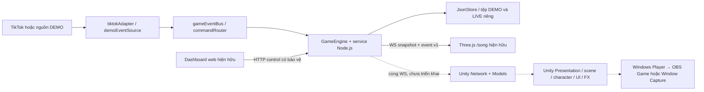

> Tài liệu dưới đây là bàn giao lịch sử giai đoạn 01. Giai đoạn 02 được người dùng yêu cầu tiếp và ghi riêng tại [UNITY_WEBSOCKET.md](UNITY_WEBSOCKET.md); các mục “chưa triển khai network” bên dưới mô tả thời điểm giai đoạn 01.

# Unity 2.5D migration — Giai đoạn 01: khảo sát và khởi tạo

Ngày 06/11/2026. Yêu cầu mới cho phép thay công nghệ trình diễn bằng Unity, thay giới hạn công nghệ Three.js trong kế hoạch cũ; **luật gameplay trong GAME_DESIGN.md giữ nguyên**. Đây là bàn giao giai đoạn 01, không phải bản game Unity đã hoạt động. Không triển khai giai đoạn 02, không commit/push.

## 1. Hiện trạng và quyết định

Đã đọc `AGENTS.md`, `GAME_DESIGN.md`, `PROGRESS.md`, `README.md`, `package.json`, `server.js`, `gameEngine.js`, `gameEventBus.js`, `public/js/network.js`; đối chiếu thêm main/presentationState/playerStore/battle snapshot, kế hoạch nền tảng, tổng quan 06 và toàn bộ bước 07. Các kế hoạch cũ là nguồn về hành vi/giới hạn cần giữ, không phải chỉ dẫn tiếp tục triển khai 07.1.

Backend hiện tại Node.js/Express/ws là nơi duy nhất tính gameplay. `GameEngine` điều phối các service, DEMO và LIVE dùng cùng engine nhưng tệp/instance riêng. WebSocket chỉ xuất snapshot/event, admin web gửi control HTTP. Three.js hiện hữu vẫn hoạt động ở `/song`; preview PNG 07.0 vẫn độc lập. Hiệu năng battle High 60 người của 06.2 còn chưa đạt và alpha/phối cảnh PNG trong ASSET_AUDIT.md chưa được nghiệm thu cho LIVE.

Đầu phiên ở branch **main**, HEAD `2e7825a8a3ff89ac845305de31542c444df54cb6`. Có sẵn thay đổi `PROGRESS.md`, audit/preview 07.0, tài liệu phases/07, ảnh concept và project Unity chưa tracked. Đã tạo **feature/unity-2-5d-migration** ngay tại HEAD cũ bằng `git switch -c`, không checkout revision khác, không stash/reset/commit/push. Thay đổi chưa commit thuộc working tree chung, **không được cô lập chỉ nhờ đổi tên branch**; không stage toàn bộ repo vì sẽ trộn công việc cũ.

Project người dùng thực tế nằm ở `public/unity-client/My project/`, Editor `6000.5.9f1`, URP `17.5.0`, có Library/Temp và Editor đang chạy. Không có `unity-client/` ở root trước phiên. Để không ghi đè, di chuyển project đang mở hoặc đưa project nguồn mới vào static web root, đã tạo project **mới** bằng Editor ở `unity-client/`. Project cũ giữ nguyên; không copy toàn bộ Library, sample hoặc package manifest nhiều tiện ích của project cũ.

### Phiên bản và render pipeline

- Máy chỉ phát hiện Editor `C:/Program Files/Unity/Hub/Editor/6000.5.9f1/Editor/Unity.exe`; Unity Hub cũng đã cài. Chọn **6000.5.9f1** để khởi tạo/kiểm chứng bằng môi trường thật, pin revision trong `ProjectVersion.txt`. **Không gọi đây là LTS**.
- Chính sách ưu tiên LTS vẫn giữ. Unity phân biệt LTS và Update; 6.3 là nhánh LTS theo [Unity release support](https://unity.com/releases/unity-6/support). 6.5 là nhánh Supported/Update, và thông báo chính thức đã ghi hết vòng hỗ trợ: [Unity 6.5 announcement](https://discussions.unity.com/t/unity-6-5-is-now-available/1723176). Không tự cài Editor hay downgrade project 6000.5 sang 6000.3. Trước khi khóa production cần chọn LTS còn hỗ trợ và kiểm tra lại package/serialization trên bản sao riêng; chưa kiểm chứng bước đó.
- **URP 17.5.0**, khớp Editor/package đã có, dùng Universal Renderer (Forward); không cần HDRP, Netcode, Entities, Cinemachine, Addressables, Timeline hoặc plugin WebSocket ở giai đoạn 01. Direct manifest chỉ URP và built-in IMGUI/UIElements cho Editor UI. Dependency bắc cầu do UPM giải quyết, có lock file; không tuyên bố mọi dependency trong lock là được thêm trực tiếp hoặc có gameplay Unity.
- Camera mặc định **orthographic**, khung khởi tạo 1080×1920, size 9.6; quy ước dự kiến 100 pixel = 1 Unity unit. Perspective chỉ cân nhắc sau khi có nhu cầu battle/mesh đã đo; không orbit làm lộ cạnh sprite. Scene hiện rỗng với camera, chưa có bố cục tông môn, parallax, safe-area/letterbox hay cơ chế camera.
- Tắt HDR/MSAA/depth/opaque texture và post-processing ở cấu hình khởi tạo; đây chưa phải các preset Low/Medium/High đã được nghiệm thu. Không sửa graphics/camera trong `caidat.json` để phục vụ Unity.

## 2. Cấu trúc project thật

```text
unity-client/
  README.md
  Verify-Project.ps1
  Assets/
    Editor/MigrationProjectSetup.cs      # utility chỉ chạy Editor
    Scripts/
      Network/                          # chưa có runtime transport
      Models/                           # chưa có DTO gameplay
      Presentation/
      Characters/
      Scenes/
      Effects/
      UI/
    Scenes/Bootstrap.unity              # chỉ Main Camera
    Settings/TuTienPipeline.asset
    Settings/TuTienRenderer.asset
    UniversalRenderPipelineGlobalSettings.asset  # URP tự sinh
    DefaultVolumeProfile.asset                   # URP tự sinh, không có Volume trong scene
    Prefabs/
    Art/
    Animations/
    Materials/
    Tests/                              # dành chỗ, chưa có test suite Unity
  Packages/manifest.json
  Packages/packages-lock.json
  ProjectSettings/                      # Editor sinh, có ProjectVersion.txt
```

Các thư mục dành chỗ có README và `.meta`, không có class stub giả làm chức năng chạy. `Scripts/Scenes` dành cho điều phối runtime tương lai; `Assets/Scenes` chứa scene asset. Editor utility tạo cấu hình/scene khi chưa tồn tại và từ chối ghi đè khi chạy Initialize lại; Verify kiểm tra cấu trúc đã lưu. Không có `[RuntimeInitializeOnLoadMethod]`, startup HTTP, TikTok hay ghi dữ liệu người chơi. Không tự chạy backend khi mở/Play Unity.

Git ignore chỉ loại Library/Temp/Logs/UserSettings/build/IDE ở project mới và generated output của project cũ. Assets, `.meta`, Packages/lock và ProjectSettings được phép version control. Không ignore cả project cũ để che file người dùng; không xóa cache đang được Editor khác sử dụng.

## 3. Kiến trúc đích — mới là thiết kế



Đích đầu tiên là **Windows Standalone x64** trên cùng máy với Node.js. Đây là lựa chọn kiến trúc, chưa build Player. Unity native không chạy JavaScript Three.js, không nhận trực tiếp module JS hoặc HTML/CSS. Khi port scene chưa đủ, streamer tiếp tục dùng Browser Source `/song`; không hứa chạy BattleScene JS bên trong Unity hay ghép hai mô phỏng. Chỉ chuyển nguồn capture sang Unity sau khi client đủ parity và được nghiệm thu. Chưa thêm WebView hoặc route Unity WebGL.

Unity chỉ giữ bản state read-only nhận từ server và trạng thái trình diễn cục bộ. `userId` là khóa, dùng seed **server đã gửi** để giữ ngoại hình ổn định; không dựa vào tên hoặc tự tạo tiến trình mới. Tu vi, damage, HP, cảnh giới, xác suất, kết quả độ kiếp, phần thưởng, chu kỳ và item đều do Node.js quyết định. Frame interpolation chỉ làm mượt, không tự tick mô phỏng hoặc cộng tài nguyên lúc mất kết nối.

## 4. Backend phải giữ

| Nhóm | File/module | Ranh giới bất biến |
|---|---|---|
| Host/transport/admin | `server.js`, `chay.bat`, `package.json`, `package-lock.json` | Loopback, Host/Origin/CSRF, API/WS, tick/commit, cách khởi chạy web cũ; giai đoạn này không sửa |
| Engine/clock | `gameEngine.js`, `cycleService.js` | Phase, đồng hồ, pause/resume, counters và session |
| Tu luyện/độ kiếp | `cultivationConfig.js`, `cultivationService.js`, `breakthroughService.js` | 11 cảnh giới, ngưỡng, probability/RNG, cooldown/bảo hộ/Thiên Mệnh |
| Vật phẩm/nhiệm vụ | `itemService.js`, `questService.js` | Năm item, buff clock, quest và pending |
| Chiến đấu/thưởng | `battleConfig.js`, `battleService.js`, `combatService.js`, `monsterFactory.js`, `rewardService.js` | 11 trường riêng, AI/HP/damage/kỹ năng, boss windows, TOP và idempotency |
| Sự kiện LIVE/DEMO | `tiktokAdapter.js`, `normalizeEvent.js`, `gameEventBus.js`, `commandRouter.js`, `liveConfig.js`, `demoEventSource.js`, `demoConnection.js` | Dedup, combo/final, giá/quy tắc quà, tim, reconnect và phân nguồn |
| Lưu trữ/bảo vệ dữ liệu | `playerStore.js`, `storage.js`, `adminData.js`, `adminDataBackup.js` | Schema/migrate/validate, atomic save, backup/confirm và lỗi ghi |
| Cấu hình/dữ liệu | `caidat.json`, `tucngu.json`, `data/demo/players.json`, `data/players.json`, backups | Không thay byte, không reset; Unity không đọc/ghi trực tiếp |
| Dashboard | `public/index.html`, `public/js/admin.js`, các Panel và `public/js/ui/*`, CSS admin | Giữ điều khiển streamer trên web; không chuyển cả admin vào Unity |

`public/js/settings.js` hiện được backend import để validate cấu hình audio/display/camera; không được xóa chỉ vì nằm dưới `public/js`. Không nhầm `gameEventBus.js` (gameplay) với hàng đợi hiệu ứng Unity. Không đưa Node.js services vào Assets hoặc viết bản C# tính thưởng song song.

## 5. Bảng ánh xạ renderer cần chuyển sau này

Tên Unity ở cột giữa là thiết kế, **chưa phải file/class đã triển khai**.

| Mã hiện hữu | Vị trí/trách nhiệm Unity dự kiến | Cách bảo toàn / trạng thái giai đoạn 01 |
|---|---|---|
| `public/js/network.js` (`connect`) | `Scripts/Network`: WS client/reconnect/dispatch | Giữ envelope/version/seq/session/dedup, chỉ nhận state; chưa viết |
| `network.js` (`control`) và admin | Web admin tiếp tục dùng API cũ | Không tự thêm endpoint hoặc gửi command từ Unity |
| `public/js/main.js` | `Scripts/Presentation` và `Scripts/Scenes`: composition/scene coordinator | Một bộ state/sự kiện, một presentation clock; chưa viết |
| `presentationState.js`, `sectLayout.js` | Presentation projection + layout/anchors | Tách tọa độ render khỏi server x/z; không mutate snapshot, không nhân đôi người lên đài |
| `scene.js`, `primitives.js` | Scene tông môn/asset layout + Prefabs/Materials | Dùng PNG được phép hoặc geometry khi được yêu cầu; chưa import/căn scene |
| `characters.js`, `proceduralCostumes.js` | `Scripts/Characters`: visual registry/pooling/pose | ID/seed ổn định, giới hạn view, không clone texture per-user; chưa port |
| `realmAura.js`, `effects.js` | `Scripts/Effects`: aura/FX pool | Cùng realm/event, ngân sách riêng; không sửa contribution |
| `breakthroughScene.js` | Ceremony presenter + animation | Server cho thời gian/kết quả; client không roll lại; chưa port |
| `camera.js` | Camera director/safe frame orthographic | Map các mode hiện hữu và focus priority, tránh rotate tranh; mới có camera mặc định |
| `battleScene.js` | Battle presentation Unity tương lai | Không thể reuse JS trong native Player; giữ `/song` cho tới khi port đủ hình/animation/boss; chưa làm |
| `overlay.js`, `battleOverlay.js`, `liveOverlay.js`, `noticeQueue.js`, HTML/CSS broadcast | `Scripts/UI`, Canvas/UI presenter + notice queue | Nội dung động thật, tên tiếng Việt, default profile ẩn theo yêu cầu thiết kế mới, không tự gán quà; chưa port |
| `audio.js` | Unity procedural audio và adapter TTS Windows tương lai | Không có Web Audio/SpeechSynthesis native; local Vietnamese voice/fallback chữ, chưa chọn package |
| `performance.js` | Quality/pool/telemetry presenter | Đo FPS/draw/texture thật, không làm gameplay chậm đi theo FPS; chưa viết |
| `public/preview-2_5d/layout.json`, `public/assets/*` | `Art`, cấu hình layout/Sprite import trong Unity | Chỉ tham khảo/tái sử dụng sau audit; chưa copy PNG hoặc tạo atlas |
| `public/song.html`, `public/css/style.css` | Giữ renderer/browser fallback hiện hữu | Không xóa/đổi route; không redirect `/song` sang Unity |

## 6. Hợp đồng mạng đã xác minh từ code

| Mục | Hiện tại | Hệ quả thiết kế cho giai đoạn sau |
|---|---|---|
| Endpoint | `ws://127.0.0.1:<port>/ws` | Server bind IPv4 loopback, kiểm Host/cổng. Native client thiếu Origin vẫn được code hiện tại cho phép; cần test bằng Unity thật sau |
| Envelope | `type`, `version:1`, `sessionId`, `seq`, `serverTime`, `payload` | `sessionId` là **transportId**, khác gameplay session dùng check-in. `seq` tăng chung cho snapshot và event; serverTime epoch milliseconds |
| Snapshot | `state:snapshot`, ngay lúc kết nối; periodic 250ms, broadcast throttle 100ms | Không tự yêu cầu resync bằng message WS. Dùng snapshot mới để dựng lại state, không cần giả định nhận đủ seq liên tục |
| Event | `game:event`; payload có `eventId`, `kind`, `userId` (có thể null), `timestamp`, trường theo kind | UI/FX ngắn hạn, không cộng lại reward/item theo event; có giới hạn/bỏ bớt hiệu ứng khi quá tải |
| Ordering/reconnect | Web client reset lastSeq khi open; đổi session xóa seen; bỏ seq cũ/trùng; seen tối đa 200 | Unity cần semantics tương đương, socket generation/cancellation, không để callback cũ thay state mới; reconnect 500ms → 1s → 2s… cap 10s |
| WS chỉ đọc | Bất kỳ application message client gửi bị đóng **1008** | Không gửi JSON ping/subscribe/ack/skill. ClientWebSocket native là hướng khảo sát, chưa có transport/package trong project |
| Commit | Event quan trọng được phát sau đường save/commit; snapshot từ committed state | Không dùng animation hoàn tất làm bằng chứng server đã phát thưởng |
| State | phase/effectivePhase, clocks, players, config, mode, battle/result, breakthrough/result, interactions | stopped/paused dùng effectivePhase để giữ cảnh và không cộng clock; không tự chuyển chu kỳ ở client |
| Chiến trường | `battle.fields` là summary, `battle.view` mới là trường đang xem chi tiết; participants keyed theo userId | Không giả định cả 11 trường có full entities. Chọn view vẫn do admin/server, client chỉ trình diễn |
| Độ kiếp | `publicState()` loại `roll`, `outcome`, `probability` của active ritual | Không đoán kết quả. Hiện kết quả chỉ khi server gửi completed/result, phục hồi từ snapshot sau reconnect |
| HTTP | `/health`, `/api/state`, `/api/dashboard`; `/api/control` qua admin hiện hữu | Unity không gọi control lúc khởi tạo. Nếu cần UI control sau này phải được yêu cầu, giữ CSRF/Origin; giai đoạn 01 không đổi API |

DTO phải thiết kế theo snapshot thực, không theo object ví dụ trong GAME_DESIGN. Key kiểu dictionary (inventory, battle participants, cooldowns `1`/`2`) và null khiến `JsonUtility` đơn thuần không đủ để parse toàn bộ protocol. Giai đoạn sau cần quyết định parser, ví dụ package Newtonsoft chính thức của Unity nếu thật sự cần; **chưa thêm package/DTO**. Timestamp/seq dùng số nguyên đủ rộng, seed unsigned 32-bit, cultivation/damage có thể là số thực; không cast mọi thứ sang `int` hoặc `float` rồi làm mất chính xác. Không deserialize dữ liệu mạng thành code/type tùy ý.

Transport native phải nhận phân mảnh WebSocket, giới hạn kích thước/queue, callback lỗi, cancellation và marshal state/FX lên Unity main thread. Khi quá tải có thể coalesce snapshot/FX theo chính sách rõ ràng, không bỏ gameplay vì gameplay không chạy ở client. Không gọi Unity API từ receive thread; không lưu toàn bộ raw payload/secret lâu dài. Các điều này **chưa triển khai và chưa kiểm chứng**.

WebGL không phải mục tiêu giai đoạn 01: System.Net.WebSockets không phải cầu nối browser tự động, origin khác cổng có thể bị backend từ chối, cần JS bridge và phân phối same-origin nếu chọn sau. Không nới Origin/Host để làm một prototype kết nối được.

## 7. PNG, bố cục và giới hạn kế thừa

Được phép dùng các PNG đã có theo ngoại lệ mới trong AGENTS.md. Xem [ASSET_AUDIT.md](../ASSET_AUDIT.md): 26 file hợp lệ kỹ thuật, 25 có alpha; nhiều canvas không chung tọa độ concept, vòng pháp trận nhìn chính diện, sân/props cắt cạnh, thiếu cành đào/aura/pose/boss. Không tuyên bố đây là bộ atlas/animation/boss đã sẵn sàng Unity.

Giai đoạn sau cần quy đổi layout 1080×1920 về tọa độ Unity theo tâm khung (X=(px-540)/100, Y=(960-py)/100 là đề xuất), xử lý pivot sau crop, sorting layers/order, alpha/SRGB, pooling và texture chung. Không copy raw layout tọa độ xuống game state hay assume x/z server là pixel. Giai đoạn 01 chưa tạo sprite importer, texture atlas, material hiệu ứng hoặc cảnh ghép. Concept `main.jpg` chỉ làm tham chiếu, không làm hình nền game.

## 8. Bảng phạm vi thay đổi trong giai đoạn 01

| File/thư mục | Thực hiện | Ngoài phạm vi |
|---|---|---|
| `unity-client/` mới ở root | Editor tạo project, URP/orthographic camera rỗng, folder skeleton, Editor setup/verify và README/script | Runtime networking/DTO, gameplay, đồ họa, import PNG, prefab nhân vật, animation, FX/UI |
| `docs/UNITY_MIGRATION.md` | Khảo sát, mapping, kiến trúc, protocol, rủi ro, baseline và hướng dẫn | Không tự tuyên bố port xong |
| `AGENTS.md` | Append ngoại lệ Unity/PNG local, ranh giới backend và giai đoạn | Không xóa chính sách Three.js/gameplay/dữ liệu |
| `.gitignore` | Exclude Unity generated output ở hai vị trí | Không ignore asset/.meta hoặc cả project nguồn |
| `PROGRESS.md` | Prepend báo cáo phiên này, giữ nguyên lịch sử audit trước | Không ghi đè kết quả/giới hạn 06.2/07.0 |
| `docs/unity-stage01/` | Lưu evidence kiểm thử chọn lọc; log chi tiết local ở test-results | Không đưa license/secret/cache vào repo |
| Backend, data/config, `public/js/*`, `/song`, preview 07.0 và project Unity cũ | Chỉ đọc/kiểm thử với data tạm; kiểm hash bảo toàn | Không chỉnh logic, xóa/di chuyển hoặc reset |

## 9. Rủi ro và điểm chặn nghiệm thu sau này

| Rủi ro | Hướng kiểm soát / phần còn cần test |
|---|---|
| Chỉ có Editor Update, không có LTS đã cài | Khởi tạo bằng bản có thật, pin Editor/URP; quyết định LTS trên bản sao trước production, không downgrade mù |
| Lệch trách nhiệm gameplay | Node authoritative; scene/camera/FX không gửi kết quả game; so cùng snapshot/fixture với web |
| Session/seq/event bị bỏ hoặc callback cũ | Contract tests, reconnect/transport đổi phiên, queue hữu hạn và snapshot repair; không phát reward từ client |
| Precision/JSON dictionary/null | DTO/parser theo payload thật, long/uint/double phù hợp; fixture JSON và dữ liệu Unicode/ID đặc biệt |
| Native/IL2CPP networking khác browser | Kiểm ClientWebSocket/receive fragments/main thread/cancellation trên Editor và Windows build; chưa thêm thư viện vội |
| URP alpha/depth/sorting/overdraw | Tông môn dùng orthographic, Sprite/shared textures và order rõ; đo trên Intel HD P530/OBS, không clone texture per-player |
| Thiếu sprite/pose/boss và không có JS battle trong Unity | Không hứa parity từ scaffold; giữ `/song` đến khi Unity scene đủ; chọn procedural/asset bổ sung khi được yêu cầu |
| TTS/audio browser không port trực tiếp | Adapter hệ điều hành cục bộ hoặc fallback chữ, không gửi tên ra dịch vụ TTS ngoài; kiểm tiếng thực |
| Unity Player khác Browser Source | Dùng Game/Window Capture sau khi có build; kiểm 9:16/scale/audio/OBS riêng, không hướng dẫn đưa exe vào Browser Source |
| Project cũ nằm trong `public/` | Giữ nguyên theo yêu cầu an toàn; project mới ở root tránh phục vụ nguồn/cache qua Express. Chưa thay static middleware để xử lý project cũ |
| Máy nhiều Editor/import khiến test nhạy thời gian | Ghi mọi lần FAIL và recheck, không tăng ngưỡng test để nhận PASS; không tắt Editor của người dùng |
| Smoke tổng hợp baseline có lỗi timing | Theo dõi riêng effect burst/skill lúc đang hồi sinh, không sửa WebSocket/AI/cân bằng trong giai đoạn khởi tạo |

## 10. Kiểm thử, hướng dẫn mở và điểm dừng

Hướng dẫn thao tác Hub và lệnh verify: [unity-client/README.md](../unity-client/README.md). Mở project root với đúng version, đợi compile rồi mở `Assets/Scenes/Bootstrap.unity`. Nếu Editor/license/import không chạy ở máy khác, đọc log và mở bằng Hub; không nhận PASS từ việc chỉ thấy thư mục Assets/Packages/ProjectSettings.

Kết quả test thực và các lần lỗi baseline được bổ sung dưới đây sau khi lệnh chạy xong. Editor batch `-nographics` chỉ chứng minh import/compile/cấu hình serialize; không chứng minh hình ảnh, Play Mode, build Windows hay sự kiện TikTok LIVE.

**Điểm dừng:** chỉ khảo sát và khởi tạo. Giai đoạn tiếp theo *nếu người dùng yêu cầu* mới làm kết nối read-only/protocol fixture; sau đó mới xem xét scene/nhân vật. Không tự bắt đầu chỉ vì Editor Verify PASS.


### Kết quả thực tế của phiên

| Lệnh / kiểm tra | Kết quả | Bằng chứng và giới hạn |
|---|---|---|
| `npm.cmd test` baseline lần đầu, trước sửa | **FAIL: 92 bài, 90 PASS / 1 FAIL / 1 SKIP** | [Log](unity-stage01/npm-baseline.txt); launcher timeout 5000ms, `status null != 1` |
| `node --test test/launcher.test.js` chạy riêng, không sửa test | **PASS 1/1** | [Log](unity-stage01/launcher-recheck.txt), không thay timeout/launcher |
| `npm.cmd test` baseline chạy lại | **PASS: 92 bài, 91 PASS / 0 FAIL / 1 SKIP** | [Log](unity-stage01/npm-baseline-recheck.txt) |
| `node scripts/live-smoke.js` | **PASS** | [Log](unity-stage01/live-smoke-baseline.txt); combo, hai chiêu, freeze EXP/buff trong battle, reconnect DEMO 5s, pending và dữ liệu tạm. Không phải LIVE thật |
| `node scripts/finishing-smoke.js`, 3 lần không sửa mã | **FAIL, còn mở** | Lần 1/3 assertion effect nhận trong cửa sổ 1s ≤84; lần 2 command bị từ chối 400 vì chưa tham chiến/đang hồi sinh. [Tóm tắt terminal](unity-stage01/baseline-observations.json), [stderr lần cuối](unity-stage01/finishing-smoke-isolated.txt). Script dừng trước xuất report nên không có số effect chính xác; không dùng report phase5 cũ để nhận PASS |
| Unity `-createProject ... -batchmode -nographics -quit` | **PASS**, log exit 0 | Project thật do Editor tạo; log chi tiết local `test-results/unity-stage01/editor-create.log` |
| Unity Editor `MigrationProjectSetup.Initialize`, rồi mở lại `Verify` | **PASS import/compile/config**, exit 0 | [Report](unity-stage01/editor-verification.json); URP, 1080×1920, orthographic size 9.6, root scene chỉ camera, Scripts chưa có runtime C#. Log chi tiết local editor-setup.log/editor-verify.log |
| `powershell -NoProfile -ExecutionPolicy Bypass -File ./unity-client/Verify-Project.ps1` | **PASS** sau sửa lỗi cú pháp script | [Output](unity-stage01/verify-command.txt). Đã sửa nội suy `$editorVersion:` thành `${editorVersion}:`. Utility thêm chặn scene chưa lưu; lượt Verify cuối đã biên dịch lại |
| `npm.cmd test` sau khởi tạo | **PASS: 92 bài, 91 PASS / 0 FAIL / 1 SKIP** | [Log](unity-stage01/npm-after.txt). Không thêm test Node hay sửa gameplay để khớp test |
| Bảo toàn file có sẵn | **PASS: 203 file SHA-256 không đổi** | [Report](unity-stage01/preservation-report.json); gồm public/renderer/project Unity cũ, phases, data và file gốc, trừ ba file tài liệu/ignore được phép sửa |
| Editor GUI/Play Mode, Unity test suite, build Windows/IL2CPP, GPU/FPS, OBS/LIVE Studio, native WS, LTS và LIVE thật | **CHƯA KIỂM CHỨNG** | Batch nographics không chứng minh các mục này; không mở LIVE thật |

Các FAIL smoke không bị xóa khỏi baseline khi npm chạy lại PASS. Ngưỡng nhận effect đã từng được ghi là nhạy timing trong lịch sử 06.1; nguyên nhân phiên này **chưa xác minh**, không kết luận do Unity hoặc do mạng. Không thay bộ giới hạn WS, AI hồi sinh, smoke assertions hay luật game ngoài phạm vi khởi tạo. Trước nghiệm thu migration gameplay cần điều tra và chạy lại nhóm FAIL này.

URP tự sinh GlobalSettings/DefaultVolumeProfile và ghi cảnh báo thông tin đó; không phải lỗi biên dịch. Log khởi động từng có licensing handshake retry, sau đó entitlement được xác nhận và Editor thoát 0. Không sao chép log license đầy đủ vào docs. Không tuyên bố Editor không có mọi warning chỉ vì Verify PASS. Test-framework/NUnit có trong dependency bắc cầu của URP/Core/Collections, không thêm trực tiếp và không có test game Unity đã chạy.

**Việc chưa kiểm chứng:** chọn và mở bằng LTS tương thích; thao tác GUI/Play Mode; native WS/DTO/dedup/threading; build Windows/IL2CPP; pipeline sprite/alpha/layout/animation/HUD/battle/audio; 9:16 mọi cửa sổ; FPS/VRAM/OBS capture; LIVE TikTok thật; vận hành dài hạn. Đồ họa và client network chưa triển khai, không chỉ là hạng mục thiếu test.

**Kết luận giai đoạn 01:** project/cấu trúc/cấu hình và tài liệu đã tạo, Editor batch đã kiểm chứng; baseline smoke tổng hợp vẫn FAIL và được giữ mở. Dừng tại đây, chưa bắt đầu giai đoạn 02, không commit/push.
